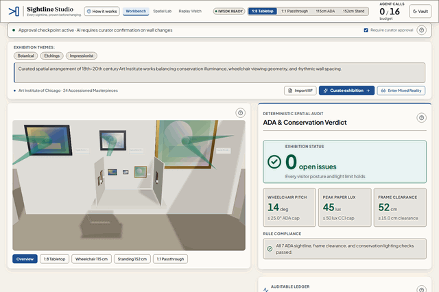
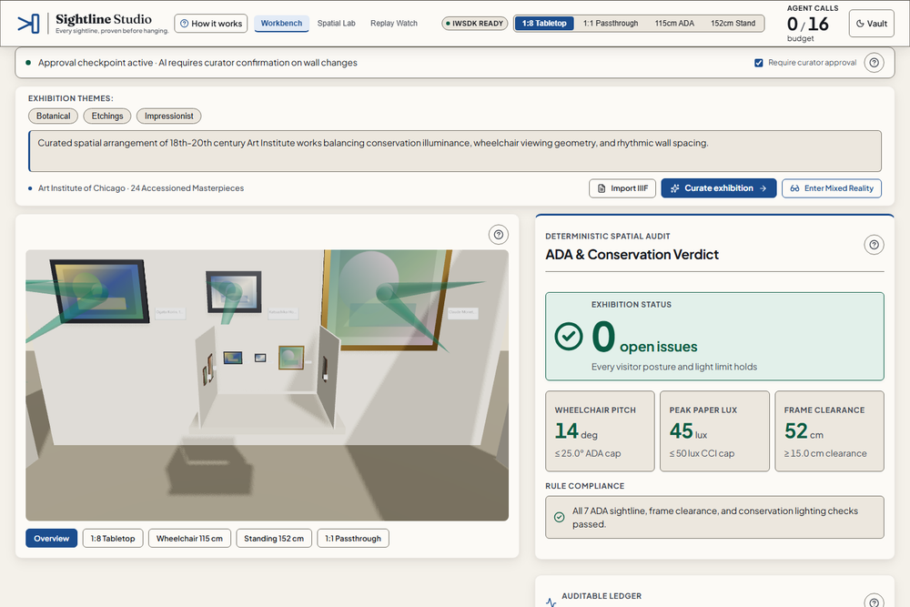
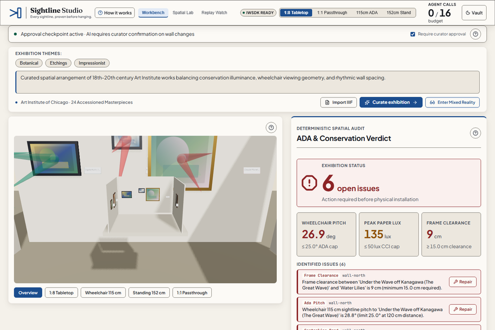
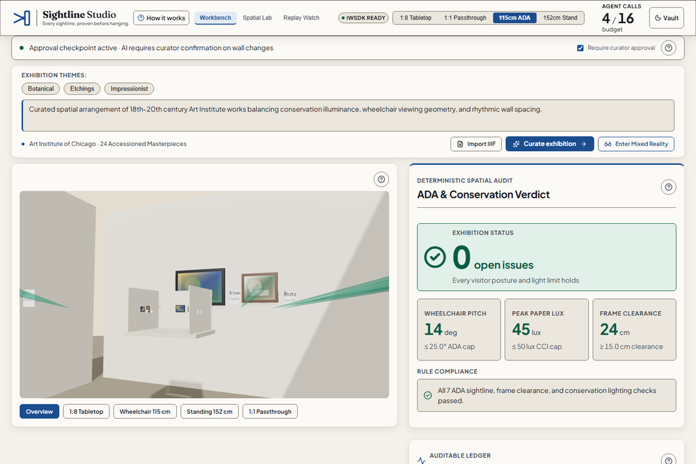
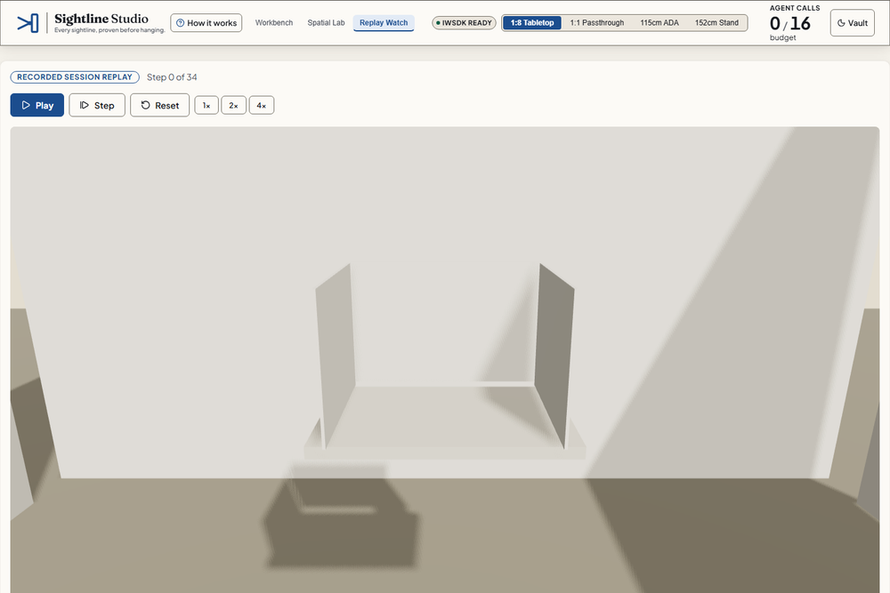
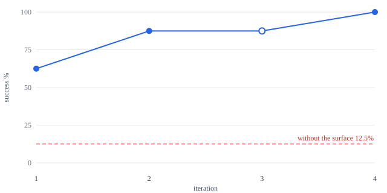

# Sightline Studio

Sightline Studio lets curators hang a gallery in a Quest 3 headset or a browser and proves, before anything is drilled, that wheelchair visitors can see every work within its light limit.

## Live demo
https://sightline-studio-7wndoy2fuq-uc.a.run.app

## Video
https://youtu.be/pending-upload

## See it
<br><sub>From the open gallery to the seated eye-level view.</sub>

| Still | Still |
|---|---|
| <br><sub>The gallery opens with every wall, frame and sightline cone in place.</sub> | <br><sub>The rule engine lists each clearance, pitch and lighting problem with its measured value.</sub> |
| <br><sub>After the curator approves the hang, the open-issue count settles at zero.</sub> | <br><sub>The watch page replays a recorded curation step by step in a separate session.</sub> |

## Try it in 2 minutes
1. Open the live demo. The gallery loads with sightline cones for a standing visitor and a seated visitor.
2. Press the Botanical theme chip, then Curate exhibition. Four model roles propose a hang, the rule engine flags what it breaks, and the repair loop fixes it.
3. When the curator checkpoint appears, press Approve change. The compliance counter settles at zero, and Replay Watch plays the recorded session back step by step.

## Why Meta Immersive Web SDK (IWSDK) & WebXR is the point
A hang is a three-dimensional decision, and a floor plan hides the thing that matters: how a wall looks from a seated eye. The Immersive Web SDK gives the project the entity sync and the WebXR session it needs to put the curator inside the room, and its emulator, IWER, lets the same hand gestures (pinch to select, pinch-drag to nudge, two-finger pinch to dismiss) run on a desktop with no headset. Every gesture goes through the same typed actions the model uses, so a human move and an agent move leave the same audit trail.

## What the agent can do
| Action | Group | What it does |
|---|---|
| `scan_room_planes` | read | Reads detected WebXR vertical wall planes in centimeters or returns the three calibrated virtual gallery walls (420x280 cm, 360x280 cm, 360x280 cm). |
| `toggle_passthrough_wall_mode` | navigate | Switches passthrough active state and view mode between 1:1 physical room passthrough and virtual gallery elevation. |
| `toggle_seated_scale_twin` | navigate | Activates or stows the 1:8 miniature tabletop gallery maquette floating 55 cm ahead inside a 60 cm (2 ft) seated reach sphere. |
| `load_iiif_collection` | cross_boundary | Parses an untrusted IIIF Presentation v2/v3 JSON string or loads the bundled 24-work Art Institute of Chicago CC0 catalog with physical centimeter dimensions an |
| `filter_curatorial_theme` | read | Ranks catalog artworks against curatorial brief keywords, theme ('botanical', 'architectural', 'impressionist', 'modernist'), and optional conservation maxLuxCe |
| `propose_wall_layout` | change | Computes a parametric wall hang ('chronological_spine', 'salon_cluster', 'symmetrical_pair') on wallIdOrName for artworkIds, verifying clearance and margins. |
| `place_framed_artwork` | change | Mounts a single framed artwork onto target wall at center coordinates (centerX_cm, centerY_cm) with track spotlight illuminance in lux, creating an accompanying |
| `adjust_frame_height` | change | Moves a mounted framed artwork vertically (centerY_cm in cm, optional centerX_cm in cm) and synchronizes its museum placard height. |
| `reflow_wall_spacing` | change | Runs reflowWallMounts across target wall so every adjacent frame and placard clears minGap_cm (default 18 cm, rule floor 15 cm) and 20 cm wall margins. |
| `set_spot_illumination` | change | Sets track spotlight illuminance in lux (15 to 300 lux) on target mount to satisfy 50 lux paper or 200 lux canvas conservation ceilings. |
| `compute_sightline_frustum` | verify | Computes 152 cm standing and 115 cm wheelchair 3D sightline cones, upward pitch angles in degrees, and angular placard legibility across the active gallery. |
| `preview_wheelchair_eye_level` | navigate | Shifts active viewMode to wheelchair_115 (115 cm eye height) or standing_152 (152 cm eye height) and selects optional mount to frame in 3D. |
| `validate_ada_compliance` | verify | Runs full seven-rule SightlineTruthEngine audit, returning all errors and warnings with measured centimeter, degree, and lux values and suggested repair calls. |
| `check_fov_label_legibility` | verify | Evaluates W3C XAUR placard angular font height (>= 1.2 degrees at 120 cm viewing distance) and verifies floating HUD offsets stay inside 30x22 degree central he |
| `repair_layout_violation` | change | Repairs compliance problems deterministically. |
| `draft_curatorial_placard` | collaborate | Writes a museum placard (curatorialNote) of 45 to 70 words (notes outside 40 to 75 words are rejected, so count before sending) and sets fontHeight_mm (>= 26 mm |
| `swap_rejected_artwork` | collaborate | Replaces currently selected mounted artwork with replacementArtworkIdOrTitle matching exhibition theme and lux ceiling, routing through ApprovalGate. |
| `pin_spatial_anchor` | change | Requests curator approval via ApprovalGate before locking SpatialAnchorRecord and saving physical gallery wall drill coordinates. |
| `scrub_timeline_snapshot` | navigate | Saves a named curatorial milestone (mode: 'save') or restores a prior milestone (mode: 'restore', snapshotIdOrLabel). |
| `export_exhibition_manifest` | cross_boundary | Exports a complete JSON hang schedule with wall coordinates in cm, spotlight settings in lux, sightline pitches in degrees, spatial anchors, and IIIF attributio |

## The truth engine
The verdicts do not come from the model. A deterministic rule engine reads the exhibition in centimetres, degrees and lux and checks wall bounds, frame clearance, the upward viewing pitch from a wheelchair eye height, the inclusive centerline band, placard placement, placard legibility and the conservation lux ceiling for each medium. The model proposes; the engine decides. Any change that persists passes through a curator approval step.

## Measured proof
<!-- hee-eval:start -->
### Measured agent success

100.0% task success (16/16) with the product's action surface against 12.5% (2/16) with generic screen actions only; 15182.8 tokens and 7.6 s per try with the surface.

| Condition | Runs | Passed | Success | Valid first-try calls (share) | Failed calls | Retries | Tokens per run | Seconds per run |
|---|---|---|---|---|---|---|---|---|
| With the product's action surface | 16 | 16 | 100.0% | 1 | 5 | 2 | 15182.8 | 7.6 |
| Generic screen actions only | 16 | 2 | 12.5% | 0.8448 | 40 | 30 | 19830.1 | 23.9 |



Measured on 8 frozen tasks, 2 repetitions each, with gemini-2.5-flash; this shows success on those tasks only.

Method: eight tasks written in the user's own words and frozen before tuning (hash `e8eb1503`); each run twice per condition with the same model; outcomes are graded from the final application state. Four iterations, each changing one aspect of the action surface; an iteration was kept only if success improved without more safety failures. Reproduce: run the evaluation harness with both conditions against `evals/scenarios.json`.
<!-- hee-eval:end -->


## Evidence
- [`actions.manifest.json`](actions.manifest.json): the typed action surface the agent and the hand gestures share.
- [`run-trace.json`](run-trace.json): one recorded curation with every model role call, action, repair round and the curator checkpoint; the `/watch` page replays it.
- [`evals/report.json`](evals/report.json): the frozen-task comparison behind the measured numbers above.

## Architecture


Source: `design_documents/architecture.draft.json` (8 nodes across `client` / `xr-engine` / `service` / `model`, `iwsdk-xr` sponsor node, 8 runtime-proof edges).

| Lane | Node | Role |
|---|---|---|
| client | Curator Workbench | Paper & Vault UI + Approval Gate |
| client | Exhibition Store | Revisions, undo & AIC IIIF catalog |
| xr-engine | Meta IWSDK + Three (sponsor) | Hands-first WebXR & 1:8 tabletop twin |
| xr-engine | Sightline Truth | 115 cm ADA pitch, XAUR & 50 lux rules |
| service | 20-Action Surface | Typed tools + human approval gate |
| service | Express SSE Hub | Progress stream & golden cache |
| model | Gemini 2.5 Pro | Curatorial planner & layout strategist |
| model | Gemini 2.5 Flash | ADA repair critic & placard writer |

Flows: Workbench → Actions (brief & approvals) → Store (20 typed actions) → IWSDK (wall & cone sync) ⇄ Actions (hand pinch & scan); Store → Truth (cm/deg/lux); SSE → Pro/Flash (theme/hang, repair/placards) → Workbench (stage stream).

```
src/
  domain/    exhibition model, store, rule engine, hang layouts, IIIF loader
  agent/     typed actions, four-role workflow, cost guard, event stream
  server/    Express API, golden replay cache, Vertex AI client
  3d/        React Three Fiber gallery, lab route, materials, sprite plaques
  xr/        IWSDK bridge, IWER hand gestures, spatial audio cues
  ui/        workbench components, design tokens, help copy
  showcase/  /watch replay route
e2e/         Playwright scenarios (real Chromium, replay mode)
evals/       frozen tasks, adapter, outcome checks
```

## What building this taught us about Meta Immersive Web SDK (IWSDK) & WebXR
1. **UIKitML wants kebab-case style properties.** `flex-direction` and `font-size` render; `flexDirection` is silently ignored, so a placard panel built with React-style names comes out unstyled.
2. **Headless Chromium paces `requestAnimationFrame` far below what the GPU can do.** A blank page measured 24 fps, and the gallery measured 30 for the same reason. With the frame-rate and vsync caps lifted the scene runs near 700 fps, so a frame-rate probe on a demand-driven canvas needs those flags to measure render cost.
3. **Environment lighting counts against the shader-program budget.** Baking a room environment compiles several programs, and a re-run of that effect (an unstable callback in its dependency list) doubled them. Keeping the bake keyed on the renderer and scene alone held the total at twelve.
4. **Start the Quest 3 emulator when the browser has no `navigator.xr`, and leave it off otherwise.** On a headset the native runtime wins; on a desktop IWER installs a Quest 3 device, and the gesture helpers route through the action registry as hand-sourced calls, which is what lets the same tests cover both.

## Develop, test, deploy
```
npm install
npm run dev            # client on :5173
npm run dev:api        # API on :8787
npm test               # unit and integration tests
npm run test:e2e       # real-browser suite, replay mode
npm run build && npm start
node scripts/deploy-cloud-run.mjs   # Cloud Run, needs gcloud auth
```
Model calls use Vertex AI with Application Default Credentials (`.env.example`).

## Licence and credits
MIT. Upstream credits: Art Institute of Chicago Open Access (CC0), Meta Immersive Web SDK and IWER, three.js, React Three Fiber; see `UPSTREAM-NOTICE.md` and `disclosure.md`.
