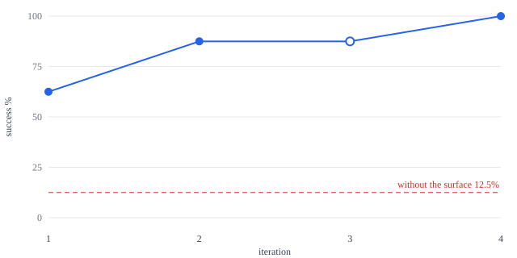

# Task success per iteration

| Iteration | Aspect | Note | Success | Kept |
|---|---|---|---|---|
| 1 | baseline |  | 62.5% | yes |
| 2 | descriptions | repairAll and issueId repair, artist query on theme filter, placard word guidance | 87.5% | yes |
| 3 | descriptions | placard length guard, final comparison | 87.5% | no |
| 4 | action_count | placard text now persists in the store | 100.0% | yes |
